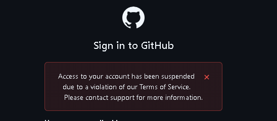

# Eduardo Gelain

**Desenvolvedor de Software e Jogos | Engenharia Reversa | Sistemas de Baixo Nível**

Desenvolvedor de Software e Jogos especializado em arquitetura de alto desempenho, sistemas de baixo nível, C++, C# e engenharia reversa. Atuo na ponte entre mecânicas de gameplay em engines comerciais e manipulação nativa de memória e sistemas em tempo real. Minha trajetória une desenvolvimento comercial, pesquisa técnica e ferramentas para a comunidade:

- **Engenharia Reversa e Sistemas Nativos:** Desenvolvimento de scanners dinâmicos de assinaturas em memória (sigscan), injeção de DLLs nativas em C++, hooking em ponteiros de despacho de bytecode (VM de GSC) e contorno de sandboxes restritos (UWP e Microsoft GDK).
- **Desenvolvimento de Jogos e QA Técnico:** Atuação profissional em Quality Assurance no lançamento comercial de Sparky Rush na Steam, identificando bugs críticos com testes de regressão e dedução de causas-raiz direto no código (Unity e C#). Criação de templates modulares de jogabilidade (Outcaster em Unity e protótipos em Unreal Engine 5 com C++).
- **Ferramentas e Otimização:** Autoria de utilitários em Python e Electron para otimização de estabilidade, integração Vulkan/DXVK e patches de memória binária, acumulando mais de 10.000 downloads e dezenas de milhares de acessos na comunidade (NexusMods e GitLab).

---

### Estatísticas

  
  

  
  

---

### Stack Técnica e Competências

- **Linguagens:** C++, C# (.NET), Python, C, x86/x64 Assembly, JavaScript, TypeScript
- **Engines e Gráficos:** Unity Engine, Unreal Engine 5, WebGL, Three.js, DirectX, Vulkan
- **Baixo Nível e Reversing:** IDA Pro, x64dbg, Win32 API, Injeção de DLLs, Memory Scanning, Hooking, UWP/GDK Internals
- **Qualidade e Ferramentas:** Dedução de código, Electron, Git, CI/CD, Profiling de Performance

---

### Projetos e Publicações

<!-- START_PROJETOS -->
### GitHub (Commits Recentes)
- [**Spet001.github.io**](https://github.com/Spet001/Spet001.github.io)  - Sem descrição.
- [**ProjectY**](https://github.com/Spet001/ProjectY)  - MDPro Web is a browser-based Yu-Gi-Oh! simulator built wiith Three.js
- [**Open-Source-T6-GSC-Mods**](https://github.com/Spet001/Open-Source-T6-GSC-Mods)  - Sem descrição.

### GitLab
- [**ResurgeCW**](https://gitlab.com/Spet001/resurgecw)  - This utility allows players with existing Steam,Battle.net,SteamTools/SkyTools, BNET Installer game files to install  the Resurge Client (GDK) - Play online on with your Xbox Account.
- [**T9GSCMods**](https://gitlab.com/Spet001/T9_GSC_Mods)    - T9 GSC Mods as Open Source - No Gatekeeping
- [**T5-T6 Fast File Editor**](https://gitlab.com/Spet001/t_5_6_ff_editor)  - A simple Python GUI for decompressesion ("decompiles") .ff fastfiles on T5 (BO1) and T6 (BO2) on MS Store (Xbox PC) version.
- [**COD GDK GSC Dumps**](https://gitlab.com/Spet001/t5-gdk-gsc-dumps)  - Dumped by using my tool: https://gitlab.com/Spet001/msclients/ - GSC Dumps from XBOX PC (GDK) CODs
- [**CW-UWP-GSC-Injector**](https://gitlab.com/Spet001/CW-UWP-GSC-Injector)  - A lightweight, zero-dependency, standalone C++ console utility that injects compiled GSC scripts into the Microsoft Store/Xbox App version of Call of Duty: Black Ops Cold War (T9).
- [**ZPGDK**](https://gitlab.com/Spet001/msclients)    - Clients for MS Store CODs- GSC Injector for MS Store (Xbox App) Black Ops 1/2, Client Manipulation, DLC Unlocker and more...
- [**ResurgeGDK**](https://gitlab.com/Spet001/resurgegdkbackup)    - Resurge Client: Play Black Ops 3 on XBOX PC Servers.

### itch.io
_Nenhum projeto encontrado._

### Nexus Mods
_Nenhum projeto encontrado._

<!-- END_PROJETOS -->

---

### Links e Portfólio

- **Portfólio:** [spet01.dev](https://spet01.dev/)
- **Journal Técnico:** [spet01.dev/journal](https://spet01.dev/journal/)
- **GitLab (Engenharia Reversa e Clientes):** [gitlab.com/Spet001](https://gitlab.com/Spet001)
- **GitHub:** [github.com/Spet001](https://github.com/Spet001)
- **itch.io (Jogos e Templates):** [spet01.itch.io](https://spet01.itch.io/)
- **Nexus Mods:** [nexusmods.com/profile/Spet001/mods](https://www.nexusmods.com/profile/Spet001/mods)
- **LinkedIn:** [Eduardo Gelain](https://www.linkedin.com/in/eduardo-gelain/)
- **Contato direto:** gelain15mj@gmail.com

---

### Trivia
*I used to be an adventurer like you, then I took a...*

 
*...in the knee.*
